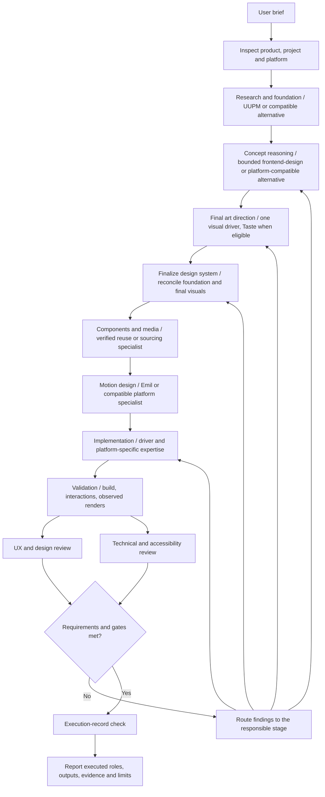

# UIUX Orchestrator architecture

A coding agent executes the orchestration instructions, invokes installed skills and gathers
actual outputs. The Markdown core defines decisions and boundaries; the bundled Python checker
validates the resulting execution record. It is not an autonomous runtime or proof that a skill
was actually executed.

## Fixed stages, compatible providers



The diagram shows full creative work: a new surface or Redesign/Replace. Existing-system screens,
supplied designs, review-only work and exact local fixes retain their scoped workflows. A fixed
responsibility does not require an incompatible skill: web-only frontend-design/Taste are not
forced onto iOS, Android, React Native or Flutter.

## Creative refinement inside an existing system

Breakthrough ambition also applies to Refresh, polish and component/interaction improvements
whenever design judgment is delegated. The scoped creative cycle keeps the same ambition at
every size and scales the number of specialist activations:

| Size | Cycle |
|---|---|
| Small (one component) | `inspect baseline → one scoped specialist weighs 2–3 approaches and owns the move → implement → matching before/after validation + self-check` |
| Medium (screen/flow) | `inspect baseline → concept → constrained visual/interaction direction → implement → before/after validation → UX/design review → refine` |
| Large | `… → specialist audit → concept → direction → implement → validation → UX/design + technical review → refine` |

An exact correction routes no specialist.

The frontend concept adapter can serve compatible web refinement inside a governing system;
a scoped visual specialist realizes the chosen move without becoming a replacement driver.
Reuse inspected product/system constraints. Reviewers identify what is distinct and why it
benefits this product/task; generic cosmetic changes do not satisfy an open creative brief.
This scoped cycle does not manufacture a ten-stage full-design record. Exact fixes and supplied
designs keep their fidelity requirements; read-only reviews provide recommendations, not edits.

## Responsibilities and authority

| Stage id | Required output | Preferred owner or routing rule |
|---|---|---|
| `inspect` | Project/platform facts, commands, asset/tool and skill inventory | Orchestrator inspects actual sources. |
| `foundation` | Evidence, product/UX analysis, patterns, hierarchy, states and provisional guidelines | UUPM search; Impeccable shape addresses discovery/gaps. Distinguish retrieved recommendations, observed facts and assumptions. |
| `concept` | Alternatives, chosen experience concept, narrative/structure and rationale | frontend-design in bounded `design-reasoning` mode on suitable web tasks; compatible concept specialist elsewhere. |
| `direction` | Final palette, typography, composition, imagery/materials, identity and responsive direction | One visual driver. Taste is first choice for eligible marketing/product/shop websites. |
| `system` | Final semantic tokens and component/state conventions, actual code locations and contrast checks | Selected driver if explicitly owned, otherwise a suitable system specialist. Normalize actual generated tokens rather than claim a document title creates a system. |
| `components` | Reuse/source decisions, real media, rights and gaps | Project/platform components first; Lucian or suitable asset/component expertise for unresolved gaps. |
| `motion` | Purpose, behavior, timing, interruption, reduced-motion path and implementation plan | Emil on compatible web tasks; Expo/Reanimated and native/platform expertise as appropriate. An explicit static decision is allowed when motion is not required. |
| `implement` | Working code consistent with accepted decisions | Driver plus scoped platform specialists. |
| `validate` | Actual static/build/interaction/render evidence | Project tooling, compatible device skills and bundled tools. |
| `review` | Separate UX/design and technical/accessibility assessments with findings and verdicts | Impeccable critique/audit or compatible evaluators, separate activations and independent contexts when available. |

Foundation palette/type/system suggestions are hypotheses. Concept reasoning chooses the
experience approach; it does not finalize the visual system. Art direction then owns final
visual choices within user/project constraints. Finalize the design system **after** this step,
reconciling its inputs from both foundation and art direction.

When findings invalidate an upstream decision, revise that owner's handoff and recheck affected
downstream outputs. Do not restart unrelated stages or let a reviewer silently impose new taste.

## A bounded concept adapter, not two full drivers

The registry still describes frontend-design as a driver for its full workflow. It additionally
declares `specialist_slots: [design-reasoning]` and a `scoped_brief` controlled by this orchestrator.
With that explicit receipt mode, execute the real skill's planning and review-against-brief work,
return the concept artifact and stop before implementation. Taste or the chosen visual driver
then executes its own creative process using that brief.

This is not an upstream command named `design-reasoning`. Reading the skill alone does not count.
Without the mode, frontend-design is subject to the normal single-driver rule. Its bounded
receipt cannot cover final art direction, implementation or prove a full driver execution.
See the installed [adapter contract](../skills/uiux-orchestrator/core/adapters.md).

## Records and enforcement

Execution record schema 2 requires the ten stages above, accepted outputs, successful activation
receipts, capability coverage, evidence and explicit `inputs` to earlier handoffs. In particular,
`concept` consumes `foundation`, `direction` consumes `concept`, and `system` consumes both
`foundation` and final `direction`. The two reviews receive the foundation, concept, direction,
system and validation evidence. The full input matrix is in the orchestration contract §2 and is
enforced by `check-orchestration.py`.

`routing` records driver eligibility separately from installation: web marketing considers Taste
before fallback, checks installed alternate Node binaries through `probe-runtime.py`, and cites
an actual user/project constraint when excluding a driver for brief fit. A self-invented 3D
requirement is not such a constraint. Explicit binary invocation does not change environment
defaults or need another permission solely because PATH resolves an older runtime.

`visual_review` links to the UX/design activation and records the nine visual-craft dimensions
as observations with rendered evidence. Boolean workflow gates and technical scores cannot
substitute for these judgments. Negative user feedback reopens the old pass until fixes have a
new rendered review; it does not require a universal user-approval gate. Older schema-2 records
need those missing assessments, not fabricated positive fields.

```bash
python3 -I skills/uiux-orchestrator/scripts/check-orchestration.py /path/to/record.json
```

Schema 1 records must be reevaluated/migrated, not merely relabeled: a formerly combined UX and
visual direction does not establish that the new foundation and concept roles actually ran.
The checker rejects missing phases/inputs, wrong ownership, incomplete activation records,
incompatible platforms, bounded-mode takeover, unjustified marketing-driver skips and missing or
failed visual assessments. Genuine specialist unavailability or declared
sequential review lowers the status ceiling; unmet requirements block completion.

The checker cannot authenticate fabricated evidence, establish actual chronology or judge
beauty. Tool logs, observed renders and independent review remain necessary. Passing automated
record, installer or routing tests is not a measured UI-quality improvement.
